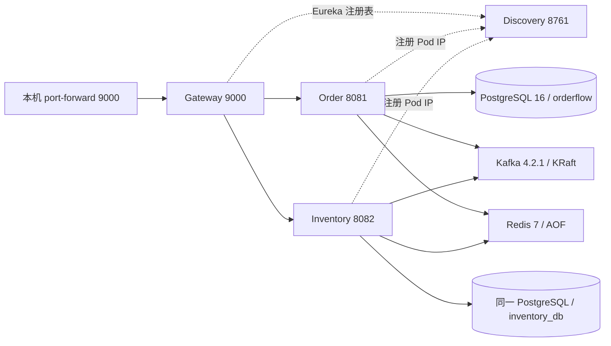

# Day 16：Kubernetes 基础清单

Day 16 完成清单、凭据创建方式和离线静态校验。**尚未执行集群部署**；Pod 启动、PVC 绑定、
私有镜像拉取、探针和业务链路的运行验收留到 Day 17。

## 目录与资源

```text
k8s/base/
  kustomization.yaml       入口、命名空间、公共标签、固定镜像、共享 Java 补丁
  namespace.yaml           orderflow
  configmap.yaml           应用配置、PostgreSQL 配置/初始化 SQL、Kafka 配置
  postgres.yaml            PostgreSQL 16 StatefulSet、headless Service、PVC 模板
  redis.yaml               Redis 7 StatefulSet、headless Service、PVC 模板
  kafka.yaml               Kafka 4.2.1 StatefulSet、客户端/仲裁 Service、PVC 模板
  discovery.yaml           Discovery Deployment、ClusterIP Service
  gateway.yaml             Gateway Deployment、ClusterIP Service
  order.yaml               Order Deployment、ClusterIP Service
  inventory.yaml           Inventory Deployment、ClusterIP Service
  java-runtime.patch.yaml  四个 Java Deployment 共用的探针、资源和安全配置
scripts/
  set-k8s-secrets.ps1       交互式创建 Secret；不输出凭据，不生成凭据文件
  validate-k8s.py           渲染、schema 与引用检查；不需要集群
  requirements-k8s.txt      静态校验依赖 PyYAML
```

`java-runtime.patch.yaml` 是 Kustomize 补丁，不是独立资源。使用 `kubectl apply -k k8s/base`，
不要对该目录执行 `kubectl apply -f`，也不要单独应用四个尚未合并公共补丁的 Deployment 文件。

除集群级的 `Namespace` 本身外，所有资源均在 `orderflow` 命名空间。
Base 渲染 20 个资源：1 Namespace、4 ConfigMap、8 Service、4 Deployment、3 StatefulSet。
运行时还需要 2 个外部 Secret；StatefulSet 控制器创建 3 个 PVC，稳态预期 7 个 Pod。



## 配置来源与 DNS

继续激活镜像中已有的 `application-docker.yaml`，不重建应用镜像。迁移来源为根目录
`docker-compose.yml` 及四个服务的 `src/main/resources/application*.yaml`。
业务超时、Gateway GET 重试/熔断、Redis 缓存 TTL、Kafka 事件与 Outbox 配置沿用原值。

| 配置/服务 | Kubernetes 中的值 | 作用 |
| --- | --- | --- |
| `SPRING_PROFILES_ACTIVE` | `docker` | 使用现有环境变量占位符 |
| `EUREKA_URL` | `http://discovery-service.orderflow.svc.cluster.local:8761/eureka/` | Gateway、Order、Inventory 注册/发现 |
| Gateway Service / 容器 | `9000` / `9000` | 集群内入口；无 NodePort/LoadBalancer |
| Order Service / 容器 | `8081` / `8081` | `lb://order-service` 路由 |
| Inventory Service / 容器 | `8082` / `8082` | `lb://inventory-service` 路由 |
| Order `DB_URL` | `jdbc:postgresql://postgres.orderflow.svc.cluster.local:5432/orderflow` | 来自 ConfigMap 的 `ORDER_DB_URL` |
| Inventory `DB_URL` | `jdbc:postgresql://postgres.orderflow.svc.cluster.local:5432/inventory_db` | 来自 `INVENTORY_DB_URL` |
| `DB_USERNAME` / `POSTGRES_USER` | `orderflow` | 非敏感用户名；两个 ConfigMap 保持一致 |
| `KAFKA_BOOTSTRAP_SERVERS` | `kafka.orderflow.svc.cluster.local:29092` | 客户端 ClusterIP Service |
| Kafka advertised listener | `kafka-0.kafka-headless.orderflow.svc.cluster.local:29092` | 元数据返回可解析的稳定 Pod DNS |
| Kafka controller voter | `1@kafka-0.kafka-headless.orderflow.svc.cluster.local:29093` | 单节点静态 KRaft quorum |
| `REDIS_HOST` / `REDIS_PORT` | `redis.orderflow.svc.cluster.local` / `6379` | 持久化缓存 |
| `TRACING_ENABLED` | `false` | 本阶段未部署 Zipkin |

这里假设集群 DNS 域为 `cluster.local`；自定义域需同时调整 ConfigMap 中的服务地址和 Kafka
advertised/controller 地址。Kafka 的 headless Service 开启 `publishNotReadyAddresses`，
使 broker 在 Ready 前即可解析自身并建立 quorum；应用仍通过普通 `kafka` Service 引导。
`enableServiceLinks: false` 避免 Kubernetes 注入的 `KAFKA_PORT` 等变量干扰镜像配置。

Eureka 的三个客户端通过 Downward API 获得 `status.podIP` 和唯一的 `metadata.name`，
配合 `EUREKA_INSTANCE_PREFERIPADDRESS=true`，注册 Pod IP 和对应应用端口。
滚动更新期间，新旧 Pod 因此具有不同的实例 ID；Gateway 的负载均衡仍由 Eureka 完成。
Discovery 自身沿用禁用 self-registration/fetch-registry 的配置。

直接绑定 Spring 配置属性的环境变量遵循“点换下划线、删除连字符、转大写”的命名规则：
例如 `eureka.instance.ip-address` 对应 `EUREKA_INSTANCE_IPADDRESS`，
`spring.lifecycle.timeout-per-shutdown-phase` 对应 `SPRING_LIFECYCLE_TIMEOUTPERSHUTDOWNPHASE`。
`DB_URL` 等现有 YAML 显式引用的占位符保持原名。规则见
[Spring Boot 环境变量绑定说明](https://docs.spring.io/spring-boot/reference/features/external-config.html#features.external-config.typesafe-configuration-properties.relaxed-binding.environment-variables)。

## 私有 GHCR 镜像与 Secret

四个 Java Deployment 均引用 [Day 15 已验收发布](day15-ghcr-summary.md) 的同一提交：
`34ed73031211b98b31b487e9182b0d26b9975a73`，仅支持 `linux/amd64`。
共享补丁通过 `nodeSelector` 限定 Linux amd64 节点。

镜像名前缀为 `ghcr.io/maknight233/orderflow-`，服务名分别为
`discovery-service`、`gateway-service`、`order-service`、`inventory-service`。
`kustomization.yaml` 同时记录完整 `sha-<40 位提交>` 标签和 Day 15 的 manifest digest；
渲染后为 `镜像:sha-<commit>@sha256:<digest>`，拉取以 digest 为准，不依赖 `main` 或 `latest`。

Base **不包含 Secret 对象或默认密码**。部署前必须在同一命名空间创建：

| Secret | 类型与 key | 使用方 |
| --- | --- | --- |
| `postgres-credentials` | `Opaque` / `POSTGRES_PASSWORD` | PostgreSQL 的 `POSTGRES_PASSWORD`，Order/Inventory 的 `DB_PASSWORD` |
| `ghcr-auth` | `kubernetes.io/dockerconfigjson` / `.dockerconfigjson` | 四个 Java Pod 的 `imagePullSecrets` |

本机/长期集群拉取私有 GHCR，需要拥有这四个 Package 读取权限的账户及 classic PAT，
只授予所需的 `read:packages`；如组织要求 SSO，还要授权 SSO。
不要复制 Day 15 Actions 的临时 `GITHUB_TOKEN` 作为长期集群凭据。
Day 15 的 CI 发布仍只使用 `GITHUB_TOKEN`，本次未修改发布认证方式。
Package UI 的访问继承状态此前未确认，部署账户应逐个核对四个 Package 的读取权限。
认证要求见 [GitHub Container Registry 文档](https://docs.github.com/en/packages/working-with-a-github-packages-registry/working-with-the-container-registry#authenticating-to-the-container-registry)。

从仓库根目录在 PowerShell 中执行，先确认当前 context 和 StorageClass：

```powershell
kubectl config current-context
kubectl get nodes -L kubernetes.io/arch
kubectl get storageclass
kubectl apply -f k8s/base/namespace.yaml
./scripts/set-k8s-secrets.ps1 -RegistryUser Maknight233
kubectl -n orderflow describe secret postgres-credentials ghcr-auth
```

脚本隐式使用当前 context，分别以隐藏输入读取新数据库密码和 GHCR token，
在内存中构造 Secret，经标准输入执行 server-side apply。凭据不进入进程参数、
仓库文件或 client-side apply 的 `last-applied-configuration` 注解。
`describe secret` 仅显示 key 和长度，避免使用 `get secret -o yaml` 输出可逆的 base64 凭据。
Secret 本身仍需集群 RBAC 和存储加密保护；base64 不是加密。
本地环境文件统一放在被 Git 忽略的 `k8s/local/`，不保存或提交真实凭据。

已有数据库 Secret 时，脚本拒绝覆盖密码。仅轮换 GHCR token 时使用：

```powershell
./scripts/set-k8s-secrets.ps1 -RegistryUser Maknight233 -RegistryOnly
```

如果首次 apply 部分成功、数据库 Secret 已创建，也使用 `-RegistryOnly` 补建 GHCR Secret。
替换数据库 Secret 不会自动修改已初始化 PVC 中的 PostgreSQL 角色密码；数据库密码轮换需
协调 `ALTER ROLE`、Secret 更新和应用重启，不重新运行首次初始化脚本。

## 持久化与迁移

| StatefulSet | 镜像 | PVC / 容量 | 挂载与行为 |
| --- | --- | --- | --- |
| `postgres` | `postgres:16` | `data-postgres-0` / 5Gi | `/var/lib/postgresql/data`；`PGDATA` 使用其中的 `pgdata` 子目录 |
| `redis` | `redis:7` | `data-redis-0` / 1Gi | `/data`；AOF，`appendfsync everysec`；128MB maxmemory、allkeys-lru |
| `kafka` | `apache/kafka:4.2.1` | `data-kafka-0` / 5Gi | `/var/lib/kafka/data`；日志位于 `logs` 子目录 |

PVC 使用 `ReadWriteOnce` 和集群默认 StorageClass，总申请 11Gi。
需要支持动态供应及 `fsGroup` 权限的 CSI/本地存储方案；没有默认 StorageClass 时 PVC 会 Pending，
应在首次部署前为三个 `volumeClaimTemplates` 指定实际可用的 `storageClassName`。
已有 PVC/StatefulSet 的存储字段存在修改限制，不能靠重新 apply 任意更换存储。

PostgreSQL 官方 entrypoint 在空数据目录创建 `POSTGRES_DB=orderflow`，随后运行
`postgres-init` ConfigMap 中的 `01-create-inventory-db.sql`，创建 `inventory_db`。
该 SQL 与 Compose 的 `docker/postgres/init/01-create-inventory-db.sql` 一致。
readiness 会使用密码实际连接两个数据库执行 `SELECT 1`。
初始化脚本仅对空数据目录生效；保留 PVC 后修改 SQL 不会重新执行。
这一行为见 [PostgreSQL 官方镜像说明](https://hub.docker.com/_/postgres#initialization-scripts)。

Order/Inventory 的表结构仍由镜像中的 `classpath:db/migration` 及 Flyway 管理，
`SPRING_FLYWAY_ENABLED=true`，Hibernate `ddl-auto=validate`；不在 ConfigMap 中复制业务 DDL。
Kubernetes 不提供 Compose 的 `depends_on` 顺序，首次数据库未就绪时应用可能启动失败后重启，
需等待依赖就绪并检查最终 rollout；startupProbe 不会阻止进程自身退出。

Kafka 使用 broker/controller 合并的单节点静态 KRaft 配置，node ID 为 1，三个默认分区，
offset/transaction replication factor 与 min ISR 均为 1，保留 Compose 的 cluster ID。
不要在复用 PVC 时随意更改 cluster ID 或 node ID。内部仅监听 29092/29093，
不发布 Compose 的外部 9092 listener，也不部署 ZooKeeper。
此模式用于演示，不提供多副本容错；Kafka/Redis 使用内部明文连接，尚未增加 TLS、SASL、
Redis ACL 或 NetworkPolicy，ClusterIP 本身不代表命名空间网络隔离。

三个 StatefulSet 均显式配置缩容/删除 StatefulSet 时保留 PVC。
**删除 Namespace 仍会级联删除其中的 PVC**，保留策略不能保护 Namespace 删除。
暂停演示可以将 Deployment/StatefulSet 缩容到 0；不要将 `kubectl delete -k k8s/base`
作为保留数据的停止命令，因为 Base 包含 Namespace。

## 探针、资源与安全配置

| Java 探针 | 端点与窗口 | 含义 |
| --- | --- | --- |
| startup | `/actuator/health/liveness`，5 秒一次，最多 60 次失败，约 300 秒 | 给 JVM/Spring 启动时间；成功后才启用另外两个探针 |
| readiness | `/actuator/health/readiness`，5 秒一次，连续 3 次失败 | 从 Service 就绪端点移除 Pod，不重启容器 |
| liveness | `/actuator/health/liveness`，10 秒一次，连续 6 次失败 | 本进程健康异常时重启容器，不探测外部依赖 |

HTTP 探针均使用当前容器命名端口 `http`，超时 3 秒。
沿用现有 Actuator health group：Discovery/Gateway readiness 只含 `readinessState`，
Order/Inventory 还含 `db`；Redis、Kafka/Eureka 不作为 Java liveness 的依赖，
避免依赖故障导致无效的级联重启。Gateway Ready 不等于 Eureka 已收敛或业务链路已通过，
需要 Day 17 单独执行只读路由预热及 Smoke 验收。
探针语义见 [Kubernetes 文档](https://kubernetes.io/docs/tasks/configure-pod-container/configure-liveness-readiness-startup-probes/)
与 [Spring Boot 文档](https://docs.spring.io/spring-boot/reference/actuator/endpoints.html#actuator.endpoints.kubernetes-probes)。

PostgreSQL 使用 `pg_isready` 做 startup/liveness，双数据库 SQL 做 readiness；
Redis 使用 `redis-cli ping`；Kafka startup/readiness 实际执行 `kafka-topics.sh --list`，
liveness 检查 broker TCP。Kafka 探针的独立 CLI heap 限定为 128Mi，避免沿用 broker 的 512Mi heap。

| 工作负载 | 每 Pod CPU requests / limits | 每 Pod 内存 requests / limits | UID/GID |
| --- | --- | --- | --- |
| 四个 Java Deployment，各 1 副本 | 100m / 1 | 384Mi / 768Mi | 10001 |
| PostgreSQL，1 副本 | 100m / 1 | 256Mi / 512Mi | 999 |
| Redis，1 副本 | 50m / 500m | 128Mi / 384Mi | 999 |
| Kafka，1 副本 | 250m / 1 | 768Mi / 1536Mi | 1000 |

稳态合计 requests 为 **800m CPU / 2688Mi 内存**，limits 为 **6500m CPU / 5504Mi 内存**，
不含集群系统组件。Java 滚动更新各允许额外一个 Pod，需为 surge 留出可调度资源；
这些初始值需要 Day 17 根据实际启动时间、OOM/CPU throttling 调整。
JVM 最大 heap 为容器内存的 65%，余量留给 metaspace、线程和直接内存。

所有 Pod 禁止自动挂载 ServiceAccount token，使用非 root UID/GID、`RuntimeDefault` seccomp，
容器禁止提权并丢弃全部 Linux capabilities。四个 Java 容器、PostgreSQL、Redis 使用只读根文件系统；
Java `/tmp`、PostgreSQL socket/tmp 和各持久卷单独可写。
Kafka 保留可写根文件系统，因为官方 entrypoint 需要生成 `/opt/kafka/config`；
其 UID 和目录写入要求已通过镜像检查及 [4.2.1 官方源码](https://github.com/apache/kafka/blob/4.2.1/docker/resources/common-scripts/configure) 核对。
卷权限由 `fsGroup` 配合存储驱动设置，不使用 root/chown initContainer。

四个 Deployment 使用 `RollingUpdate`：`maxUnavailable=0`、`maxSurge=1`、
`minReadySeconds=10`、progress deadline 600 秒，保留 3 个旧 ReplicaSet。
Java 终止宽限期 60 秒：先 `preStop` 等待 10 秒给端点/Eureka 传播留时间，
然后 Spring 执行 graceful shutdown，每个关闭阶段上限 30 秒。
PostgreSQL/Redis 终止宽限期 60 秒，Kafka 为 90 秒。
单副本 Discovery/数据库/Kafka 本身仍有可用性限制，滚动策略不等于整个系统零中断保证。

## 静态校验与本次结果

前置工具：Python 3.10+、kubectl（自带 Kustomize）、kubeconform。
从 [kubeconform 官方 Releases](https://github.com/yannh/kubeconform/releases) 安装，
下载二进制时校验发行版 `CHECKSUMS`；工具和输出放在被 Git 忽略的 `target/` 下。

```powershell
python -m venv target/day16/venv
target/day16/venv/Scripts/python.exe -m pip install -r scripts/requirements-k8s.txt
kubectl kustomize k8s/base
# kubeconform 已在 PATH 时省略 --kubeconform
target/day16/venv/Scripts/python.exe scripts/validate-k8s.py --kubeconform target/tools/kubeconform/kubeconform.exe
git diff --check
```

脚本输出渲染清单 `target/day16/rendered.yaml`，以 Kubernetes `1.35.0` schema 进行严格校验，
不使用 `ignore-missing-schemas`。首次运行需要联网下载公开 schema，但不连接 Kubernetes API。
可用 `--kubernetes-version` 指定目标 schema。脚本还检查重复 YAML key、命名空间、
Service/Deployment selector、Service 与探针端口、ConfigMap key、外部 Secret name/key、
volumeMount、StatefulSet governing Service、DNS，以及与 Day 15 记录一致的四个镜像 digest。
外部 Secret 的真实值、是否存在和凭据有效性需要 Day 17 在目标集群验证。

2026-10-20 本次校验记录：

| 检查 | 结果 |
| --- | --- |
| `kubectl kustomize k8s/base` | PASS：20 个资源；kubectl v1.36.1 / Kustomize v5.8.1 |
| kubeconform v0.8.0，Kubernetes 1.35.0 strict schema | PASS：Valid 20 / Invalid 0 / Errors 0 / Skipped 0 |
| YAML 唯一 key、资源引用、端口、namespace、digest | PASS：7 个工作负载、8 个 Service；两个外部 Secret 合同匹配 |
| 检查器负例 | PASS：故意写错 Secret key、删除 ConfigMap key、写错挂载卷/Service targetPort、改用 main 镜像、Eureka 指向 localhost，6 项均被拒绝 |
| Secret 脚本 | PASS：PowerShell AST 解析；使用假值模拟首次编码、拒绝覆盖数据库 Secret、RegistryOnly 更新、缺 Namespace 失败，4 项通过 |
| Spring 配置绑定 | PASS：使用现有 Order JAR 的 Spring Boot/Eureka 依赖，实际 Binder 读取 Pod IP、prefer-ip-address、实例 ID 及 30 秒 shutdown timeout |
| 官方基础镜像身份 | PASS：本地运行 `id`，postgres/redis UID 999，Kafka UID 1000；检查 Kafka 写入路径 |
| 集群创建、Secret 创建、镜像拉取、业务 Smoke | **未执行**，Day 17 待验证 |

本次模拟不读取真实凭据、不访问集群；校验工具、负例文件和渲染结果均在忽略的 `target/day16/` 下。
本阶段未改动 Java 源码或 Day 15 发布 workflow，未重复 Maven/Docker Smoke 全套测试。

## Day 17 部署与运行验收

先完成上文 context/StorageClass 检查、Namespace 和两个 Secret 创建，再从根目录执行：

```powershell
kubectl apply -k k8s/base
kubectl -n orderflow rollout status statefulset/postgres --timeout=300s
kubectl -n orderflow rollout status statefulset/redis --timeout=300s
kubectl -n orderflow rollout status statefulset/kafka --timeout=600s
kubectl -n orderflow rollout status deployment/discovery-service --timeout=600s
kubectl -n orderflow rollout status deployment/order-service --timeout=600s
kubectl -n orderflow rollout status deployment/inventory-service --timeout=600s
kubectl -n orderflow rollout status deployment/gateway-service --timeout=600s
kubectl -n orderflow get pods,services,pvc
kubectl -n orderflow get events --sort-by=.lastTimestamp
kubectl -n orderflow port-forward service/gateway-service 9000:9000
```

新终端可访问 `http://localhost:9000/actuator/health/readiness`。
Eureka Dashboard 可另行 `kubectl -n orderflow port-forward service/discovery-service 8761:8761`。
所有对外访问均为临时本机 port-forward；本阶段未配置 Ingress 或自动 CD。

Day 17 验收清单：

- [ ] 核对目标 context、Linux amd64 节点与默认 StorageClass；三个 PVC Bound，7 Pod Ready，资源实际使用无 OOM/throttling 异常。
- [ ] 四个私有镜像成功拉取；检查 Pod `status.containerStatuses[].imageID` 与 Day 15 digest 一致，无 ImagePullBackOff。
- [ ] 从 Pod 内验证服务 DNS；核对 Eureka 三个客户端的唯一实例 ID、Pod IP 和 9000/8081/8082 端口。
- [ ] 确认 `orderflow`、`inventory_db` 均存在；Order/Inventory Flyway migration 成功，`flyway_schema_history` 和业务表正确。
- [ ] Kafka controller quorum、topic 创建、生产/消费正常；没有 advertised listener 或启动 DNS 死锁；Redis AOF 可写。
- [ ] 通过 Gateway 先完成只读路由预热，再验证库存创建、订单、Saga 成功/补偿、Outbox/幂等及缓存行为；记录请求和结果。
- [ ] 依赖故障时 readiness/liveness 行为符合上述分组；startup 不误杀慢启动，数据库故障不会触发 Java liveness 级联重启。
- [ ] 在已备份的演示环境重建数据 Pod，确认 PostgreSQL 数据、Kafka 消息和 Redis AOF 保留；不删除 PVC 或 Namespace。
- [ ] 验证应用滚动更新期间唯一 Eureka 注册、流量切换和 graceful shutdown；检查终止日志、未完成请求及窗口。
- [ ] 记录权限、探针、存储、端到端链路的实测结果；再决定资源调整、网络隔离及后续自动部署范围。

ConfigMap 的环境变量不会自动刷新已启动进程。修改配置并 apply 后，需对受影响的工作负载执行
`kubectl -n orderflow rollout restart deployment/<name>`；Kafka 配置变更也需要受控重启并复核 PVC 身份。
应用回滚可使用 Deployment 的 rollout history/undo，但数据库 Flyway 迁移不会随镜像回滚自动撤销。
